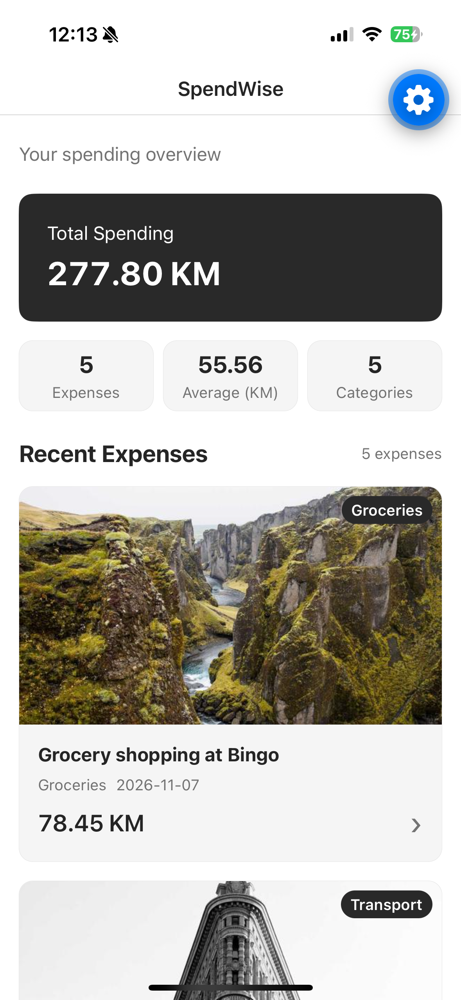
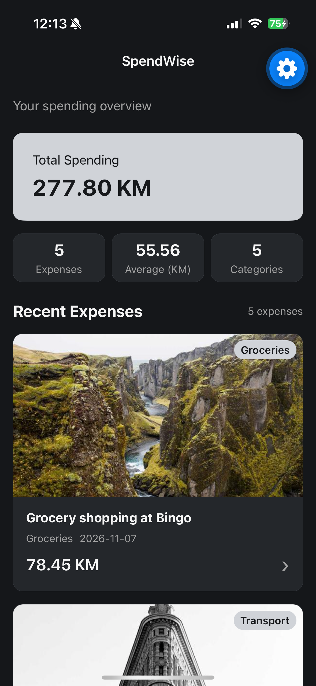

# SpendWise — Personal Expense Tracker

SpendWise is a cross-platform mobile application that helps users manage their personal finances by recording expenses, organizing them into categories, and monitoring their spending. Users can add, view, edit, and delete expenses, attach receipt photographs, and access their personal financial records through a secure account.

## Technologies

- React Native
- Expo
- TypeScript
- Expo Router
- React Hooks
- Supabase (planned)

## Getting Started

1. Clone the repository, or open your existing project folder. If cloning:

   ```bash
   git clone https://github.com/Mir3a/spendwise.git SpendWise
   cd SpendWise
   ```

2. Install dependencies from the project folder:

   ```bash
   npm install
   ```

3. Start the Expo development server:

   ```bash
   npx expo start
   ```

4. Open the application using Expo Go by scanning the displayed QR code, or choose another supported Expo development target, such as the web browser or a development build.

To run the development checks:

```bash
npx tsc --noEmit
npm run lint
```

## Features

- [x] Expense TypeScript type
- [x] Mock expense data
- [x] ExpenseCard component
- [x] ExpenseDetails component
- [x] Home Screen expense list
- [x] Total Spending calculation
- [x] Summary statistics: expense count, average expense amount, and unique category count
- [x] Light and Dark Mode themes
- [x] Automatic system theme detection
- [x] Responsive expense card grid
- [x] Responsive ExpenseDetails layout
- [ ] Navigation to expense details
- [ ] Add new expenses
- [ ] Edit and delete expenses
- [ ] Camera/gallery receipt attachment
- [ ] User authentication
- [ ] Supabase database integration
- [ ] Persistent expense storage
- [ ] Home, Expenses and Profile navigation

ExpenseDetails is an implemented reusable component, not a navigable details screen. ExpenseCard presses currently log the selected expense ID.

## Screenshots

### Light mode



### Dark mode



## Project Structure

```text
src/
├── app/
│   ├── index.tsx                 # Home Screen, summaries, and responsive expense grid
│   └── _layout.tsx               # Themed Expo Router Stack and status bar
├── components/
│   ├── ExpenseCard.tsx           # Themed expense card with category badge
│   └── ExpenseDetails.tsx        # Responsive expense information component
├── constants/
│   └── theme.ts                  # Colors, spacing, font sizes, and corner radii
├── hooks/
│   └── use-theme.ts              # System appearance-based theme selection
├── data/
│   └── expenses.ts               # Local mock expenses
└── types.ts                      # Expense and ExpenseCategory types
```


